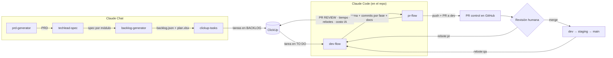

# AI-Driven Development Flow

Implementación del flujo de Ingeniería Digital: una tarea viaja de ClickUp a producción
con **una skill de Claude a cargo de cada paso**.

> Las decisiones que tomé y el porqué de cada una están en
> **[DECISIONES.md](DECISIONES.md)**.



## Qué hay aquí

| Ruta | Qué es |
|---|---|
| `skills/<nombre>/SKILL.md` | Las seis skills, con sus plantillas, referencias y scripts |
| `shared/` | Estándar de definición de tarea y convenciones de ClickUp (fuente única) |
| `skills/backlog-generator/scripts/build_plan.py` | Valida `backlog.json` y genera el plan en Excel (olas paralelas y camino crítico) |
| `skills/pr-flow/scripts/ai-cost.mjs` | Costo de IA por rama, calculado con los transcripts de Claude Code |
| `templates/repo/` | Lo que se instala en cada repo de proyecto: CI del PR, plantilla de PR, `CLAUDE.md`, runner de checks |
| `scripts/build.sh` | Ensambla las skills y genera los .zip para Claude Chat |
| `scripts/install.sh` | Instala dev-flow y pr-flow y las plantillas en un repo |
| `examples/` | Un brief y un backlog de ejemplo para probar el flujo |
| `docs/clickup-setup.md` | Estados, campos y MCP de ClickUp |

## Las seis skills

| Momento | Skill | Entra | Sale | Dónde |
|---|---|---|---|---|
| Iniciar proyecto | `prd-generator` | Idea, brief o conversación | PRD con RF numerados, MVP y fases | Chat |
| | `techlead-spec` | PRD | Spec por módulo, ordenada por dependencia de datos | Chat |
| Crear tareas | `backlog-generator` | PRD + spec | `backlog.json` validado + `plan.xlsx` | Chat |
| | `clickup-tasks` | Requerimiento o `backlog.json` | Tareas en BACKLOG con tipo, tags y dependencias | Chat + MCP ClickUp |
| Hacer la tarea | `dev-flow` | Link o ID de la tarea | Rama con commits por fase + documentación, sin push | Code |
| | `pr-flow` | Tarea cerrada por dev-flow | PR a `dev` + tarea en PR REVIEW con métricas | Code + MCP ClickUp |

## Puesta en marcha

1. **ClickUp**: sigue [docs/clickup-setup.md](docs/clickup-setup.md).
2. **Skills de Chat**:
   ```bash
   scripts/build.sh
   ```
   y sube `dist/prd-generator.zip`, `techlead-spec.zip`, `backlog-generator.zip` y
   `clickup-tasks.zip` en claude.ai → Settings → Capabilities → Skills.
3. **Cada repo de proyecto**:
   ```bash
   scripts/install.sh ../mi-repo
   ```
   Después ajusta `.claude/flow.config.json` (los checks reales), crea y protege la rama
   `dev`, y conecta el MCP de ClickUp en Claude Code.

## Requisitos
Node ≥ 20, git, `gh` autenticado, Python 3 con `openpyxl` (solo para generar el Excel
fuera de Claude Chat) y una cuenta de ClickUp con el MCP conectado.

## Probar sin ClickUp

```bash
python3 skills/backlog-generator/scripts/build_plan.py examples/backlog-ejemplo.json plan.xlsx
```
```bash
node skills/pr-flow/scripts/ai-cost.mjs --branch <rama> --repo <ruta-a-un-repo>
```

## Demo de punta a punta
Los tres primeros pasos ya están ejecutados sobre el brief de ejemplo, junto con lo que
se corrigió en las skills después de correrlos: **[examples/demo](examples/demo/README.md)**.

1. En Claude Chat, con las 4 skills subidas: pega `examples/brief-ejemplo.md` y pide
   "arranquemos este proyecto". Sigue con techlead-spec → backlog-generator →
   clickup-tasks.
2. En un repo instalado con `install.sh`: `/dev-flow CU-<id>` → aprueba el plan →
   aprueba las fases → `/pr-flow`.
