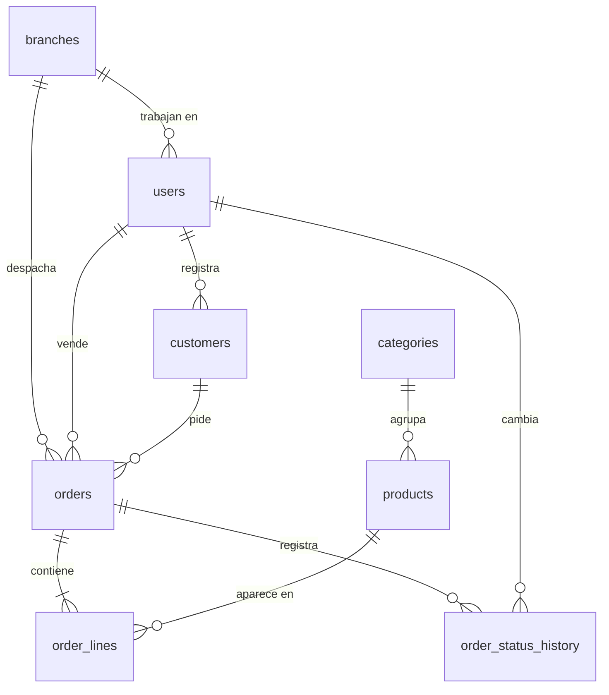

# Spec técnica — Pedidos Ferretería

**Versión:** 1.0 · **Fecha:** 2026-11-02 · **Entrada:** `01-prd.md` v1.0

> Generado con la skill `techlead-spec`. La validación global de módulos y las preguntas
> por módulo quedaron sin responder (consigna de la prueba): se aplicaron las propuestas
> por defecto y quedan como *Decisiones del módulo*.

## Decisiones técnicas
| Decisión | Porqué |
|---|---|
| Dos repos: `ferreteria/pedidos-api` (backend) y `ferreteria/pedidos-web` (frontend) | Separación de despliegue y convención del flujo: una tarea ejecutable toca un solo repo |
| Backend: Node 22 + TypeScript + Fastify + PostgreSQL 16, con migraciones SQL versionadas | Un solo lenguaje en todo el equipo; Postgres maneja bien la búsqueda por texto (RNF-02) y los montos exactos (`NUMERIC`) |
| Frontend: React + Vite + TypeScript, mobile-first | RNF-01; build estático simple de desplegar |
| Sesión con cookie httpOnly y contraseñas con hash argon2 | RNF-04 sin guardar tokens en el navegador |
| Montos en `NUMERIC(14,2)`, nunca `float` | Dinero exacto en totales y reportes |
| Búsqueda con `pg_trgm` sobre nombre y código | < 1 s con 5.000 productos (RNF-02) sin un motor de búsqueda aparte |
| Paginación por defecto de 20, máximo 100 | Respuestas acotadas en celular |

## Orden de módulos
| # | Módulo | Capa | Depende de | Cubre |
|---|---|---|---|---|
| 1 | Catálogos (`catalogo`) | catálogo | — | RF-01, RF-02, RNF-02 |
| 2 | Identidad (`identidad`) | identidad | 1 (usuarios pertenecen a una sucursal) | RF-10, RNF-04 |
| 3 | Clientes (`clientes`) | entidad | 2 | RF-03 |
| 4 | Pedidos (`pedidos`) | transacción | 1, 2, 3 | RF-04 a RF-08, RNF-03, RNF-05 |
| 5 | Reportes (`reportes`) | transacción (lectura) | 4 | RF-09 |

## Modelo de datos

---

## Módulo 1 — Catálogos (`mod:catalogo`)

**Capa:** catálogo · **Depende de:** ninguno · **Cubre:** RF-01, RF-02, RNF-02
**Repos:** `ferreteria/pedidos-api`, `ferreteria/pedidos-web`

### Datos
| Tabla | Campo | Tipo | Reglas |
|---|---|---|---|
| branches | id, name | serial, text | name único; 3 filas iniciales por migración |
| categories | id, name | serial, text | name único; se crean al importar si no existen |
| products | id, code, name, category_id, price, active, updated_at | serial, text, text, int, numeric(12,2), bool, timestamptz | code único; price ≥ 0; active default true; índice trigram en name y code |

### Contratos
| Operación | Ruta | Entrada | Salida | Errores |
|---|---|---|---|---|
| Importar | `POST /api/products/import` (admin) | multipart `.xlsx` | `{ created, updated, deactivated: 0, errors: [{ row, reason }] }` | 400 archivo inválido, 403 |
| Buscar | `GET /api/products?q=&page=` | — | `{ items: [{ id, code, name, category, price }], total }` | 401 |
| Sucursales | `GET /api/branches` | — | `[{ id, name }]` | 401 |

### Pantallas
| Pantalla | Para quién | Qué muestra | Acciones | Estados |
|---|---|---|---|---|
| Importar catálogo | Administrador | Selector de archivo y resultado de la última importación | Subir Excel | Vacío, subiendo, resultado con errores por fila |

La búsqueda de productos no tiene pantalla propia: es un componente dentro del alta de pedido (módulo 4).

### Comportamiento y reglas de negocio
- Importar crea o actualiza por `code`; nunca borra. Un producto que deja de venir en el Excel sigue activo (la desactivación es Fase 2, RF-11).
- Fila inválida (sin código, precio no numérico o negativo, nombre vacío) → se reporta con su número de fila; el resto se importa.
- Solo se listan productos activos.

### Casos borde
- Código repetido dentro del mismo Excel → gana la última fila y se reporta como advertencia.
- Archivo de más de 10.000 filas → 400 con mensaje claro.

### Decisiones del módulo
- La importación es síncrona: 2.000 filas se procesan en segundos; una cola sería complejidad sin beneficio.
- Las rutas de este módulo se protegen con el middleware de identidad (módulo 2), que se aplica a todas las rutas `/api` al implementarse. El orden catálogo → identidad se mantiene porque `users` depende de `branches`.

---

## Módulo 2 — Identidad (`mod:identidad`)

**Capa:** identidad · **Depende de:** 1 · **Cubre:** RF-10, RNF-04
**Repos:** `ferreteria/pedidos-api`, `ferreteria/pedidos-web`

### Datos
| Tabla | Campo | Tipo | Reglas |
|---|---|---|---|
| users | id, email, name, password_hash, role, branch_id, active | serial, text, text, text, enum, int, bool | email único; role ∈ admin, gerente, vendedor, bodega; branch_id obligatorio para vendedor y bodega |
| sessions | id, user_id, expires_at | uuid, int, timestamptz | expira a las 12 h |

### Contratos
| Operación | Ruta | Entrada | Salida | Errores |
|---|---|---|---|---|
| Login | `POST /api/auth/login` | `{ email, password }` | cookie de sesión + `{ id, name, role, branch }` | 401 genérico |
| Logout | `POST /api/auth/logout` | — | 204 | — |
| Yo | `GET /api/auth/me` | — | `{ id, name, role, branch }` | 401 |
| Usuarios | `GET/POST /api/users`, `PATCH /api/users/:id` (admin) | `{ email, name, role, branchId, password?, active? }` | usuario sin hash | 400, 403, 409 email repetido |

### Pantallas
| Pantalla | Para quién | Qué muestra | Acciones | Estados |
|---|---|---|---|---|
| Login | Todos | Email y contraseña | Entrar | Error genérico, cargando |
| Usuarios | Administrador | Lista con rol, sucursal y estado | Crear, editar, desactivar | Vacío, error |

### Comportamiento y reglas de negocio
- Middleware de autorización por rol en todas las rutas `/api` salvo login.
- Un usuario desactivado pierde sus sesiones al instante.
- El primer admin se crea con un comando de seed, no desde la UI.

### Casos borde
- Admin intenta desactivarse a sí mismo → 400 (siempre queda al menos un admin activo).
- 5 intentos fallidos en 10 min para un email → 429 durante 10 min.

### Decisiones del módulo
- Sin recuperación de contraseña por correo en el MVP: la restablece el admin. Evita depender de un proveedor de correo.

---

## Módulo 3 — Clientes (`mod:clientes`)

**Capa:** entidad · **Depende de:** 2 · **Cubre:** RF-03
**Repos:** `ferreteria/pedidos-api`, `ferreteria/pedidos-web`

### Datos
| Tabla | Campo | Tipo | Reglas |
|---|---|---|---|
| customers | id, tax_id, business_name, contact_name, phone, email, address, created_by, active | serial, text, text, text, text, text, text, int, bool | tax_id único; business_name y phone obligatorios |

### Contratos
| Operación | Ruta | Entrada | Salida | Errores |
|---|---|---|---|---|
| Buscar | `GET /api/customers?q=&page=` | — | `{ items, total }` | 401 |
| Crear | `POST /api/customers` (vendedor, admin) | campos de la tabla | cliente | 400, 409 tax_id repetido |
| Editar | `PATCH /api/customers/:id` | campos parciales | cliente | 400, 404, 409 |

### Pantallas
| Pantalla | Para quién | Qué muestra | Acciones | Estados |
|---|---|---|---|---|
| Clientes | Vendedor | Lista con búsqueda por razón social o identificador fiscal | Crear, editar | Vacío, error |
| Formulario de cliente | Vendedor | Campos del cliente | Guardar | Validación por campo |

### Comportamiento y reglas de negocio
- Los clientes son compartidos entre sucursales (un cliente empresa puede comprar en cualquiera).
- No se borran: se desactivan (tienen pedidos asociados).

### Decisiones del módulo
- El identificador fiscal se guarda como texto normalizado (sin espacios ni guiones), sin validar el formato de un país concreto.

---

## Módulo 4 — Pedidos (`mod:pedidos`)

**Capa:** transacción · **Depende de:** 1, 2, 3 · **Cubre:** RF-04 a RF-08, RNF-03, RNF-05
**Repos:** `ferreteria/pedidos-api`, `ferreteria/pedidos-web`

### Datos
| Tabla | Campo | Tipo | Reglas |
|---|---|---|---|
| orders | id, number, customer_id, branch_id, seller_id, status, notes, total, created_at | serial, int, int, int, int, enum, text, numeric(14,2), timestamptz | number correlativo único; status ∈ pendiente, preparado, despachado, cancelado |
| order_lines | id, order_id, product_id, qty, unit_price, line_total | serial, int, int, int, numeric(12,2), numeric(14,2) | qty > 0; unit_price copiado del producto al crear (RNF-05) |
| order_status_history | id, order_id, from_status, to_status, user_id, at | serial, int, enum, enum, int, timestamptz | solo inserción (RNF-03) |

### Contratos
| Operación | Ruta | Entrada | Salida | Errores |
|---|---|---|---|---|
| Crear | `POST /api/orders` (vendedor) | `{ customerId, branchId, notes?, lines: [{ productId, qty }] }` | pedido con líneas y total | 400 sin líneas o producto inactivo |
| Listar | `GET /api/orders?status=&branchId=&mine=&page=` | — | `{ items, total }` filtrado por rol | 401 |
| Detalle | `GET /api/orders/:id` | — | pedido + líneas + historial | 403, 404 |
| Cambiar estado | `PATCH /api/orders/:id/status` | `{ status }` | pedido | 409 transición inválida, 403 |

### Máquina de estados
| Desde | Hacia | Quién |
|---|---|---|
| pendiente | preparado | bodega de la sucursal del pedido |
| preparado | despachado | bodega de la sucursal del pedido |
| pendiente | cancelado | vendedor que lo creó, o admin |
| cualquier otra | — | 409 |

### Pantallas
| Pantalla | Para quién | Qué muestra | Acciones | Estados |
|---|---|---|---|---|
| Nuevo pedido | Vendedor | Cliente, sucursal, buscador de productos, líneas, total | Agregar/quitar líneas, confirmar | Sin líneas (confirmar deshabilitado), error al confirmar sin perder líneas |
| Mis pedidos | Vendedor | Sus pedidos con estado y fecha | Ver detalle, cancelar si pendiente | Vacío, error |
| Bandeja de bodega | Bodega | Pendientes y preparados de su sucursal, del más antiguo al más nuevo | Marcar preparado / despachado | Vacío, error, conflicto (otro ya lo movió) |

### Casos borde
- Dos bodegueros mueven el mismo pedido a la vez → el segundo recibe 409 y la bandeja se refresca.
- Un producto se desactiva mientras el vendedor arma el pedido → 400 indicando la línea.

### Decisiones del módulo
- Total calculado en el servidor; el del cliente es solo de vista.
- Bodega refresca la bandeja cada 30 s (polling). Tiempo real con websockets es Fase 2 si hace falta.

---

## Módulo 5 — Reportes (`mod:reportes`)

**Capa:** transacción (lectura) · **Depende de:** 4 · **Cubre:** RF-09
**Repos:** `ferreteria/pedidos-api`, `ferreteria/pedidos-web`

### Contratos
| Operación | Ruta | Entrada | Salida | Errores |
|---|---|---|---|---|
| Resumen mensual | `GET /api/reports/monthly?month=AAAA-MM` (gerente, admin) | — | `[{ branch, dispatchedOrders, totalAmount }]` + fila total | 400 mes inválido, 403 |

### Pantallas
| Pantalla | Para quién | Qué muestra | Acciones | Estados |
|---|---|---|---|---|
| Resumen del mes | Gerente | Tabla por sucursal + total, mes seleccionable | Cambiar mes | Mes sin datos, error |

### Comportamiento y reglas de negocio
- Cuenta pedidos con estado `despachado` cuyo cambio a despachado ocurrió en el mes (S-05), según `order_status_history`.
- Mes en la zona horaria del negocio, no UTC.

### Decisiones del módulo
- Consulta directa sin tablas de resumen: con el volumen de 3 sucursales no se justifica.

---

## Matriz de trazabilidad
| Requerimiento | Módulo(s) |
|---|---|
| RF-01 | 1 |
| RF-02 | 1 (API), 4 (componente de búsqueda) |
| RF-03 | 3 |
| RF-04, RF-05, RF-06, RF-07, RF-08 | 4 |
| RF-09 | 5 |
| RF-10 | 2 |
| RNF-01 | todos los frontends |
| RNF-02 | 1 |
| RNF-03, RNF-05 | 4 |
| RNF-04 | 2 |

Siguiente paso: diseño visual de las pantallas listadas y `backlog-generator` con PRD + esta spec.
